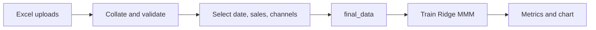

# Marketing Mix Model (MMM) engine

A Streamlit application that ingests marketing spend and sales history from Excel, prepares a training dataset, and fits a Ridge regression model with adstock and seasonality. The UI walks you through upload, validation, column selection, and model evaluation—including a chart of actual vs predicted sales on the held-out test period.

## Objective

Marketing mix modeling estimates how each channel’s spend relates to sales (or another outcome), so teams can compare channels and reason about budget allocation. This project is a **version 1 MMM engine** that:

1. **Unifies messy inputs** — Combine up to five `.xlsx` files that may use different column names, date formats, or missing channels.
2. **Enforces data quality** — Validate dates and numeric fields before training.
3. **Trains an interpretable baseline** — Chronological 80/20 train/test split, geometric adstock per channel, Fourier seasonality features, and Ridge regression with standardized features.
4. **Surfaces results in the UI** — Metrics, coefficients, test-set predictions, and an actual-vs-predicted line chart.

The goal is a clear end-to-end path from spreadsheets to a first model you can inspect—not a production attribution platform.

## How it works (process)

The app is organized into five steps. Under the hood, `model_training.py` runs when step 5 is reached.



### 1. Upload Excel files

Upload **1 to 5** `.xlsx` files. Each file is read with pandas (`openpyxl`).

### 2. Collated data preview

- All files are merged on the **union of column names**.
- If a column is missing in a file, cells are filled with `*` and highlighted **red** in the preview.
- Rows are sorted by date when a `date` column (any common casing) is detected.
- Validation checks include valid calendar dates and numeric values in non-date columns.

### 3. Select columns for training

You choose:

| Selection | Rule |
|-----------|------|
| **Date** | Any column; must parse to valid dates |
| **Sales** | Outcome column (e.g. sales, revenue) |
| **Channels** | **4 or 5** marketing spend columns (more than 3, fewer than 6) |

Channel columns must be numeric in the collated data used for training.

### 4. Training data preview

The app builds **`final_data`**: date, sales, and selected channels, sorted ascending by date. You see:

- Which channels are included
- Row counts per channel
- Any missing values after coercion
- A preview table ready for modeling

### 5. Model evaluation

`train_and_evaluate()` in `model_training.py`:

1. Drops rows with missing values in required columns.
2. Splits **80% train / 20% test** by time (no random shuffle).
3. **Adstock** — Per-channel geometric adstock; decay rates are tuned on training MSE.
4. **Seasonality** — Sine/cosine Fourier terms based on inferred frequency (daily / weekly / monthly).
5. **Scaling** — `StandardScaler` fit on training features only.
6. **Ridge regression** — Default `alpha = 1.0`.

The UI shows train/test sizes, MSE, RMSE, MAE, R², MAPE (when defined), scaled-feature coefficients, a test prediction table (actual, predicted, residual), and a **line chart** of actual vs predicted sales on the test set.

## Project layout

| File / folder | Role |
|---------------|------|
| `app.py` | Streamlit UI: upload, collation, validation, training prep, evaluation display |
| `model_training.py` | Adstock, seasonality, Ridge training, metrics, and `train_and_evaluate()` API |
| `test_streamlit.py` | Generates synthetic FMCG-style monthly Excel files for UI and model testing |
| `synthetic_data/` | Example and generated test datasets (not required to run the app) |
| `prompt_log.md` | Development prompt history for this repo |

## Getting started

### Prerequisites

- Python 3.10+ recommended
- Packages: `streamlit`, `pandas`, `numpy`, `scikit-learn`, `openpyxl`

Example install:

```bash
python -m venv .venv
.venv\Scripts\activate
pip install streamlit pandas numpy scikit-learn openpyxl
```

### Run the MMM app

```bash
streamlit run app.py
```

Open the URL shown in the terminal, upload your Excel files, select columns, and scroll to section 5 for results.

### Generate synthetic test data

Creates up to five monthly `.xlsx` files with varied schemas (date formats, column names, optional Instagram, etc.):

```bash
python test_streamlit.py
```

Output defaults to `synthetic_data/`. You can also run `streamlit run test_streamlit.py` for a small generator UI.

### Run training from the command line (optional)

If `synthetic_data/*.xlsx` exists, you can evaluate without the UI:

```bash
python model_training.py
```

This collates sample files, builds `final_data`, trains, and prints metrics to the console.

## Data expectations

- **One row per time period** (typically daily), with a date and sales outcome.
- **4–5 channel columns** with numeric spend (or proxies).
- **Chronological order** is applied after collation; the model always respects time when splitting and evaluating.
- Multiple files are useful when channels or formats differ by month or source; missing columns are marked with `*` in the collated preview but must be fully numeric in `final_data` for training.

## Limitations (v1)

- Ridge on hand-built adstock + Fourier terms is a **baseline**, not a full Bayesian or hierarchical MMM.
- No budget optimization, saturation curves, or external validation beyond the chronological test holdout.
- Upload limit of five files and exactly four or five channels are fixed in the UI.

For the sequence of features added during development, see `prompt_log.md`.
